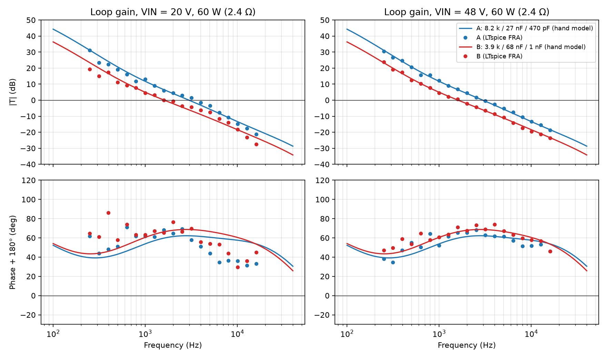
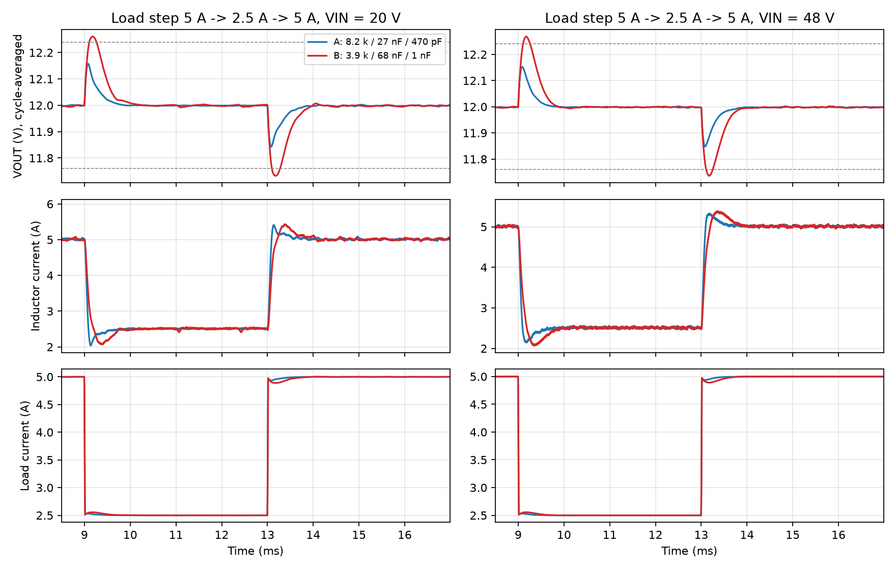
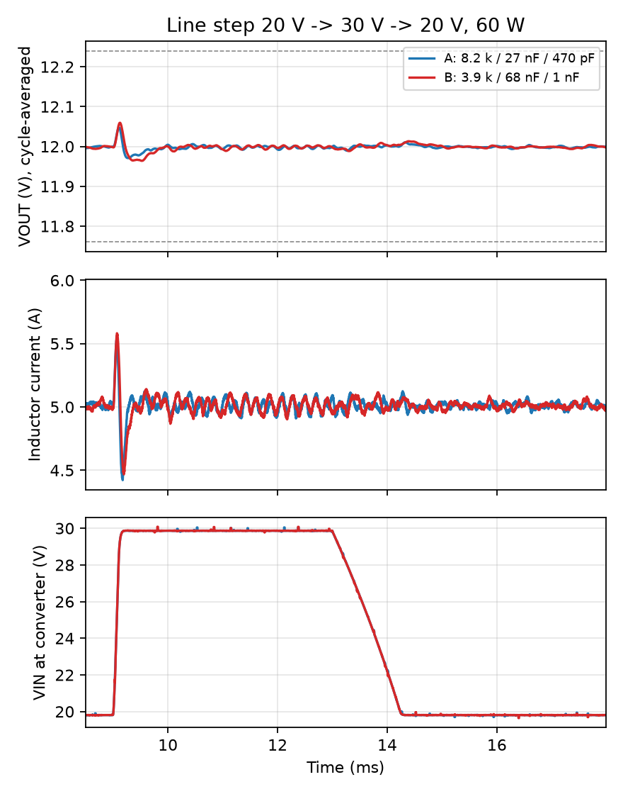

# Paket 3 — Kompanzasyon B önerisi ve A/B karşılaştırması (transient bonusu)

Tarih: 2026-11-15. Hazırlayan: Yiğit (Claude Code ile). LTspice 26.0.2.
Bütün sayılar **simülasyon (model)**; ölçüm değil.

## 0. Özet

| | A (nihai) | **B (öneri)** |
|---|---|---|
| RITH / CITH / CITHP | 8,2 k / 27 nF / 470 pF | **3,9 k / 68 nF / 1 nF** |
| Sıfır / HF kutbu | 719 Hz / 41 kHz | 600 Hz / 41 kHz |
| fc (FRA, 20 V / 48 V, 60 W) | 3,56 / 3,02 kHz | 1,63 / 1,68 kHz |
| Faz payı (FRA, 20 V / 48 V) | 54,4° / 64,0° | 66,5° / 70,3° |
| Kazanç payı (16 kHz'e kadar faz 0°'ı kesmiyor) | > 21 / > 19 dB | > 27 / > 24 dB |
| Yük adımı 5 ↔ 2,5 A, tepe sapma | ±151–159 mV | ±261–270 mV |
| ±60 mV bandına dönüş | 0,29–0,33 ms | 0,57–0,59 ms |
| Hat adımı 20 → 30 V (100 µs), tepe sapma | +50 mV | +60 mV |

- B, A'nın yaklaşık yarı bant genişliğinde ve 6–12° daha fazla faz payıyla çalışıyor.
- Bedeli: yük adımında sapma ~1,7 kat, toparlanma ~2 kat. B'de 2,5 A'lık adım ±%2 bandını (±240 mV) kısa süreliğine
  ~20–30 mV aşıyor. Bu geçici bir sapma; sürekli hal şartını etkilemiyor.
- İki ayarda da toparlanmada salınım yok (ters yönde aşma ≤ 8 mV). Yani A zaten iyi sönümlü; B'nin kazancı
  dalga şeklinde değil, kararlılık payında.
- **Öneri: kartta A kalsın.** B, bonus karşılaştırmasının ikinci ayarı ve donanımda faz payı beklenenden düşük
  çıkarsa (ör. çıkış kapasitesi/ESR farkı, 20 V'ta salınım) hazır yedek.

## 1. Koşullar ve model farkı

- Netlist tabanı: `LTspice_RevF1/RevF1_G_fra90_20V.cir` (konfigürasyon G) + nihai RevF1 değerleri
  (RFREQ 24,3 k, RGH 4,7 Ω). LM74700 davranışsal v2, CRUN 1 nF, CHF 3×100 nF dahil.
- **MOSFET'ler VDMOS modeli**, resmî Infineon `_L0` değil: kütüphane pakette yok (`models/infineon/` git dışı).
  Döngü çalışması MOSFET ayrıntısına duyarlı değil; yine de H ile birebir aynı konfigürasyon değil.
  H'nin kendi FRA'sı (paket 2b): 20 V/60 W'ta 3,67 kHz / 59,0°. Buradaki A: 3,56 kHz / 54,4°.
- 60 W (2,4 Ω), 27 °C. Prime 8 ms (CSS 22 nF), sonra `.loadstate`. 90 W'ta B koşulmadı.
- FRA: `@LOOP OUT–FBOUT`, 250 Hz–16 kHz, 3 nokta/oktav. 20 kHz üstü noktaları LTspice atladı.
  Tek periyot ortalaması olduğu için noktalar gürültülü: 20 V'ta ±2 dB / ±10° saçılma var.
- Adım testleri: yük 2,4 ↔ 4,8 Ω (10 µs kenar); hat 20 → 30 → 20 V (kaynakta 100 µs kenar).
  Vout metrikleri bir anahtarlama periyodu üzerinden ortalanmış dalgadan.

## 2. El hesabı

Döngü: `T(s) = Hdiv · gm · Z_ITH(s) · Gi · Fh(s) · Zout(s)`

| Büyüklük | Değer | Kaynak |
|---|---|---|
| Hdiv = 10 k / 150 k | 0,0667 | geri besleme bölücüsü |
| gm | 2 mS | LTC3895 veri sayfası (kontrol edin) |
| Gi (ITH → bobin akımı) | **12,4 A/V** | FRA'ya oturtuldu (48 V, A); veri sayfasından türetilmedi |
| Fh: fsw/2'de çift kutup, Q | 0,35 | FRA'ya oturtuldu |
| Çıkış: C / ESR | 660 µF / 10 mΩ | 2 × 330 µF, netlist değeri |
| Yük kutbu 1/(2π·R·C) | 100 Hz | 2,4 Ω |
| ESR sıfırı | 24 kHz | |

Kompanzasyon köşeleri:

| | fz = 1/(2π·RITH·CITH) | fp = 1/(2π·RITH·CITHP) |
|---|---|---|
| A | 719 Hz | 41,3 kHz |
| B | 600 Hz | 40,8 kHz |

Orta bantta (fz < f < fp) `Z_ITH ≈ RITH`, çıkış `≈ 1/(2πfC)`. Geçiş frekansı:

`fc ≈ Hdiv · gm · RITH · Gi / (2π·C)`

- A: 0,0667 · 2 m · 8,2 k · 12,4 / (2π · 660 µ) = **3,27 kHz**
- B: 0,0667 · 2 m · 3,9 k · 12,4 / (2π · 660 µ) = **1,56 kHz**

Faz payı (yalnız baskın terimler): `PM ≈ 90° + atan(fc/fz) − atan(fc/100 Hz) − atan(fc/fp) − (Fh gecikmesi)`

- A: 90 + 77,6 − 88,2 − 4,5 − ~11 ≈ **64°**
- B: 90 + 68,9 − 86,3 − 2,2 − ~5 ≈ **65°**

Tam model (`simulation/compensation_AB/comp_model.py`) A için 2,98 kHz / 62,2°, B için 1,60 kHz / 66,3° veriyor.

**Akım sınırı dalının etkisi.** ITH'ye ayrıca CERR 10 nF + RERR 20 k + (RCS 2 k ∥ CCS 10 nF) dalı bağlı. Normalde
CC op-amp'ı doyumda ve BAT54 kesimde, yani dal pasif; ama CS düğümü bobin akımını 0,08 V/A ile taşıyor. Modelde
`Kcs·Gi ≈ 0,08 · 12,4 ≈ 0,99` çıktığı için dalın iki ucu neredeyse birlikte hareket ediyor ve 8 kHz'lik CS kutbunun
altında ITH'yi pek yüklemiyor. Bu yüzden yukarıdaki basit formülde yalnız RITH kullanıldı. Bu bir model sonucu;
donanımda Gi farklı çıkarsa dalın yükü de değişir.

**Model ile FRA uyumu** (`reports/figures/bode_A_vs_B.png`):
- 48 V: iki kompanzasyonda da ~1 dB / ~5° içinde. Model yalnız A/48 V'a oturtuldu; B eğrisi öngörü.
- 20 V: kazanç 2–5 kHz'te modelden ~2 dB yüksek, faz 4 kHz üstünde modelden 15–20° düşük. Model bunu yakalamıyor
  (D = 0,6'da eğim kompanzasyonu ve örnekleme etkisi muhtemel sebep; doğrulanmadı). A'nın 20 V'ta 54°'ye
  inmesinin sebebi bu bölge; B'nin geçişi (1,6 kHz) bu bölgenin altında kaldığı için fazı etkilenmiyor.

## 3. Yük adımı (5 A ↔ 2,5 A)

| | A, 20 V | B, 20 V | A, 48 V | B, 48 V |
|---|---|---|---|---|
| Yük atma, tepe (mV) | +159 | +262 | +154 | +270 |
| Yük alma, tepe (mV) | −155 | −266 | −151 | −261 |
| Tepe zamanı (µs) | 78–80 | 175–182 | 86–87 | 171–172 |
| ±60 mV'a dönüş (ms) | 0,30 / 0,33 | 0,57 / 0,59 | 0,29 / 0,29 | 0,57 / 0,57 |
| Ters yönde aşma (mV) | 3–4 | 7–8 | 1–3 | 4–5 |

Kaba el tahmini `ΔV ≈ ΔI / (2π·fc·C)`: A için ~180 mV, B için ~370 mV. Simülasyon ikisinde de daha düşük,
oran (~1,7) tahmine (~2) yakın.

## 4. Hat adımı (20 → 30 → 20 V)

| | A | B |
|---|---|---|
| Yükselen kenar, tepe (mV) | +50 | +60 |
| Düşen kenar, tepe (mV) | +12 | +13 |
| ±60 mV dışında kalma | yok | yok |

- Tepe akım kontrolü hattı doğal olarak bastırdığı için iki ayar arasındaki fark küçük.
- Düşen kenar yavaş: ideal diyot kesiyor, giriş kapasitesi yükle boşalıyor (~8 V/ms). Donanımda da böyle olacak.
- Bonus için ayırt edici test yük adımı; hat adımında fark ölçüm gürültüsüne yakın çıkabilir.

## 5. Donanım planı

- B'yi kurmak için üç parça değişiyor: RITH1 3,9 k, CITH1 68 nF, CITHP1 1 nF. CITH için C0G öneririm
  (X7R'nin toleransı ve gerilim bağımlılığı sıfır frekansını kaydırır). **68 nF C0G'nin CITH1 footprint'ine
  uyan parçası ve stoğu kontrol edilmedi.**
- Aynı koşullarda iki ayar: aynı VIN, aynı yük adımı, aynı prob/osiloskop ayarı. Yük akımı adımı çıkışla
  birlikte kaydedilmeli (şartname).
- Önerilen test noktaları: 20 V ve 48 V'ta 5 ↔ 2,5 A; hat için 20 ↔ 30 V (lab kaynağının kendi kenar hızıyla).
- Karşılaştırılacak büyüklükler: tepe sapma, toparlanma süresi, salınım sayısı.

## 6. Açık noktalar

1. gm = 2 mS'i veri sayfasından teyit edin; Gi FRA'dan oturtuldu, bağımsız bir el türetmesi yok.
2. Resmî Infineon modeliyle (H) B için FRA ve adım koşuları yapılmadı.
3. 90 W'ta B'nin FRA'sı ve 5 ↔ 7,5 A adımı koşulmadı.
4. Tolerans taraması yok (çıkış kapasitesi, ESR, RITH/CITH).
5. Kısa devre dönüşü ve akım sınırı B ile koşulmadı. B'de ITH daha yavaş hareket ettiği için dönüş tepesi
   (A'da 12,34 V) değişebilir.

## Dosyalar

| Dosya | İçerik |
|---|---|
| `simulation/compensation_AB/gen_p3.py` | netlist üretimi ve koşu (`prime`, `main`, `steps`) |
| `simulation/compensation_AB/comp_model.py` | el modeli |
| `simulation/compensation_AB/analyse_p3.py` | FRA/adım analizi, şekiller |
| `simulation/compensation_AB/p3_results.json` | bütün sayılar |
| `reports/figures/*.png` | şekiller |
| `docs/prereport_control_loop.md` | ön rapor için İngilizce bölüm |
