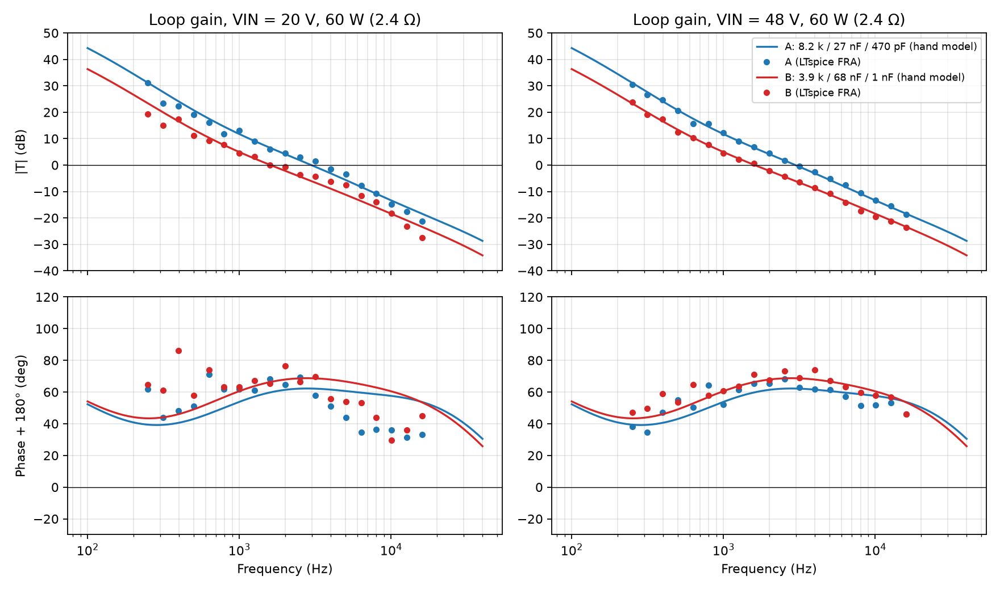
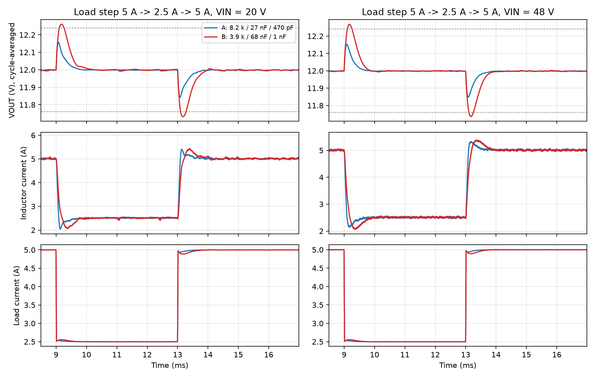
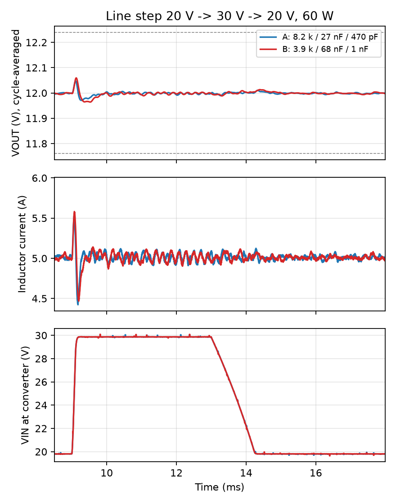

# Control Loop Design and Compensation

*Pre-report section. All results below are from simulation (LTspice 26.0.2); no hardware measurement has been made yet.*

## 1. Control approach

The converter uses the LTC3895 synchronous buck controller in forced continuous mode with constant-frequency
peak current-mode control (fsw = 94.3 kHz). The control structure has two loops:

- **Inner current loop.** The inductor current is sensed on a 4 mΩ shunt at the output side of the inductor.
  Each cycle the top MOSFET turns off when the sensed current reaches the level set by the ITH pin voltage.
- **Outer voltage loop.** The output is divided by 140 kΩ / 10 kΩ and compared with the 0.8 V reference by the
  controller's transconductance error amplifier. Its output current drives the compensation network on ITH.

Peak current-mode control was preferred over voltage-mode control for three reasons. The inductor behaves as a
controlled current source, so the power stage is close to a single-pole system and a simple Type-II network is
enough. Input voltage changes are rejected inside the current loop, which matters for a 20–48 V input range.
The current command is bounded cycle by cycle, which supports the current-limit bonus.

A separate average-current loop (LT6105 current-sense amplifier, LT1636 integrator) pulls ITH down through a diode
when the output current exceeds 7.88 A. In normal operation this loop is inactive.

## 2. Small-signal model

The loop gain is

T(s) = H_div · g_m · Z_ITH(s) · G_i · F_h(s) · Z_out(s)

| Quantity | Value | Note |
|---|---|---|
| H_div = 10 k / 150 k | 0.0667 | feedback divider |
| g_m | 2 mS | error amplifier transconductance (datasheet) |
| G_i | 12.4 A/V | ITH-to-inductor-current gain, calibrated on the simulated loop gain |
| F_h | double pole at fsw/2, Q = 0.35 | sampling effect of the current loop, calibrated |
| C_out, ESR | 660 µF, 10 mΩ | 2 × 330 µF polymer |
| Z_out | R ∥ (ESR + 1/sC) | load pole 100 Hz at 2.4 Ω, ESR zero 24 kHz |

Between the compensation zero and the high-frequency pole, Z_ITH ≈ R_ITH and Z_out ≈ 1/(sC), so the crossover
frequency is

f_c ≈ H_div · g_m · R_ITH · G_i / (2π · C_out)

and the phase margin is approximately

PM ≈ 90° + atan(f_c / f_z) − atan(f_c / f_load) − atan(f_c / f_p) − (lag of F_h)

with f_z = 1/(2π R_ITH C_ITH) and f_p = 1/(2π R_ITH C_ITHP).

## 3. Compensation designs

Two Type-II settings were designed. Setting A is the one fitted on the PCB. Setting B is a deliberately slower,
more conservative alternative used for the line and load transient comparison.

| | A | B |
|---|---|---|
| R_ITH / C_ITH / C_ITHP | 8.2 kΩ / 27 nF / 470 pF | 3.9 kΩ / 68 nF / 1 nF |
| Zero f_z | 719 Hz | 600 Hz |
| Pole f_p | 41.3 kHz | 40.8 kHz |
| Hand estimate of f_c | 3.27 kHz | 1.56 kHz |
| Hand estimate of PM | ≈ 64° | ≈ 65° |

Design targets were a crossover below fsw/10 (9.4 kHz), a phase margin of at least 45° over the whole input range,
and a high-frequency pole near fsw/2 to filter switching ripple on ITH.

## 4. Loop gain verification

The loop gain was obtained with the LTspice frequency response analyser on the full switching model, by injecting
between the output and the top of the feedback divider (250 Hz to 16 kHz, 60 W load).

| | A, 20 V | A, 48 V | B, 20 V | B, 48 V |
|---|---|---|---|---|
| f_c (kHz) | 3.56 | 3.02 | 1.63 | 1.68 |
| Phase margin | 54.4° | 64.0° | 66.5° | 70.3° |
| Gain margin | > 21 dB | > 19 dB | > 27 dB | > 24 dB |

The phase does not reach −180° inside the analysed range, so the gain margin is given as a lower bound at 16 kHz.

The hand model was calibrated only on setting A at 48 V. It then predicts setting B within about 1 dB and 5° at
48 V. At 20 V the simulated phase above 4 kHz is 15–20° lower than the model. The duty cycle is 0.6 there, and we
attribute the extra lag to the current-loop sampling effect, which the simple F_h term does not capture well.
This is the reason setting A has its lowest phase margin at 20 V. Setting B crosses over below this region and is
not affected.

## 5. Transient comparison

Both settings were tested with identical steps. Output voltage values are averaged over one switching period.

**Load step, 5 A ↔ 2.5 A (10 µs edges):**

| | A, 20 V | B, 20 V | A, 48 V | B, 48 V |
|---|---|---|---|---|
| Overshoot at load release (mV) | +159 | +262 | +154 | +270 |
| Undershoot at load application (mV) | −155 | −266 | −151 | −261 |
| Time to return within ±60 mV (ms) | 0.30–0.33 | 0.57–0.59 | 0.29 | 0.57 |
| Excursion of opposite sign during recovery (mV) | ≤ 4 | ≤ 8 | ≤ 3 | ≤ 5 |

**Line step, 20 V → 30 V in 100 µs at 60 W:** peak deviation +50 mV (A) and +60 mV (B). The output stays inside
±60 mV for both. On the falling edge the input capacitors discharge into the load at about 8 V/ms and the
deviation is below 15 mV.

**Discussion.** Halving the bandwidth roughly doubles the recovery time and increases the load-step deviation by a
factor of 1.7, in line with ΔV ≈ ΔI / (2π f_c C_out). Neither setting rings, so the additional phase margin of B
does not produce a visibly better waveform; it only adds robustness against component tolerances. With setting B
a 2.5 A step briefly exceeds the ±2 % band by 20–30 mV. The ±2 % requirement applies to steady state, where both
settings settle within 3 mV of 12.00 V. Line steps are rejected mainly by the current loop, so they separate the two
settings much less than load steps. Setting A is therefore kept as the main design and setting B is kept as the
comparison case and as a fallback if the hardware shows less phase margin than the model.

## 6. Limitations and next steps

- The MOSFETs in these runs use generic VDMOS models. Efficiency and switching results in the other sections use
  the manufacturer models; the loop results should be repeated with them.
- The modulator gain G_i was fitted to the simulation and not derived independently from the datasheet.
- Setting B has not yet been checked at 90 W, in current limit, or after a short-circuit release.
- No tolerance analysis of C_out, ESR, or the compensation parts has been done.
- In hardware, setting B will be installed by replacing the three ITH components. The same load and line steps
  will be recorded together with the load current for both settings.
