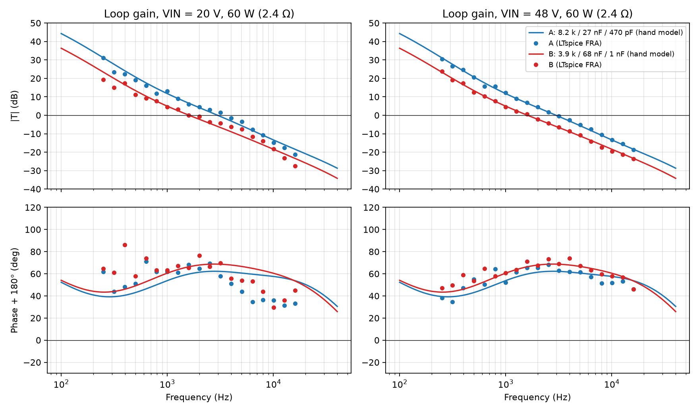
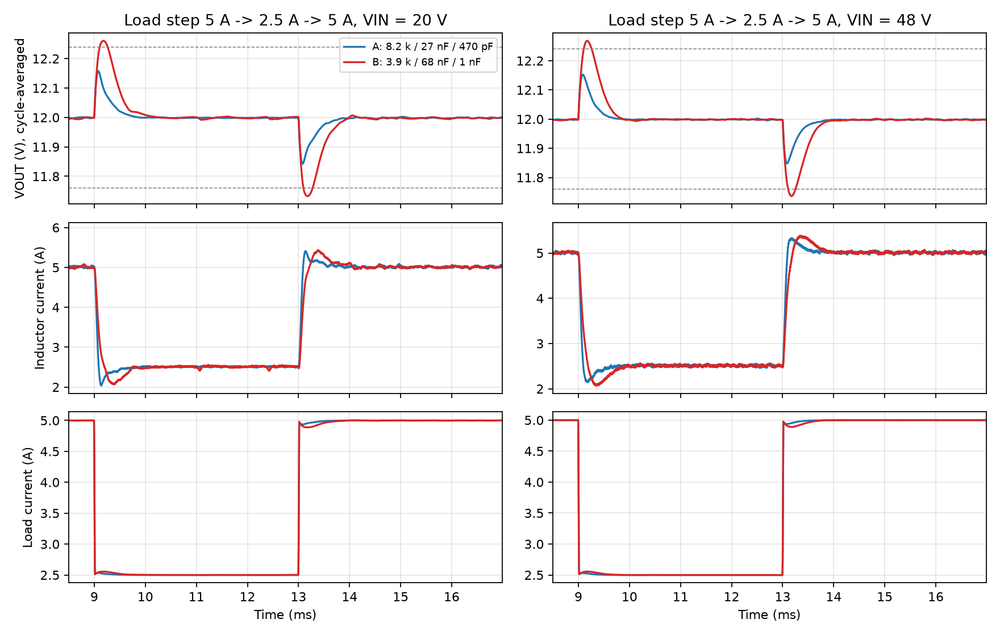
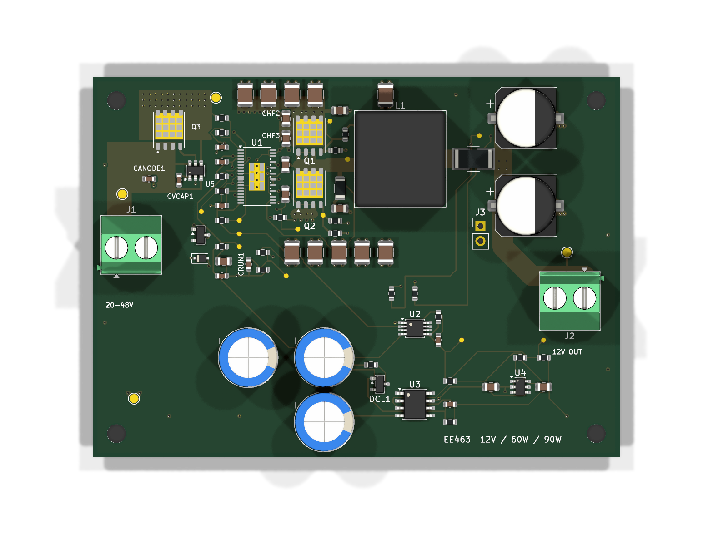

# EE463 Hardware Project: Pre-Report (Design and Simulation)

**60 W, 20–48 V to 12 V synchronous buck converter with closed-loop control**

| | |
|---|---|
| Course | EE463 Static Power Conversion I, METU, Fall 2026 |
| Group | *Group X* (fill in names and student IDs) |
| Design revision | RevF2 (schematic, PCB and BOM in this repository) |
| Date | 19 November 2026 (pre-report due 22 November 2026) |

> **Status.** Every number in this report comes from hand calculation or LTspice simulation. No hardware has been
> built yet. Simulation results are marked *(sim)*. Measured results will be added in the final report.

---

## 1. Specification and design targets

| Item | Requirement (course) | Design target (this group) |
|---|---|---|
| Input voltage | 20–48 V DC, one external source | Same; tested range 16.8 V (RUN on) to 58 V (OVLO) |
| Output | 12 V, 5 A, 60 W, resistive (2.4 Ω) | Same + 90 W overload (7.5 A, 1.6 Ω) |
| Regulation | ±2 % (11.76–12.24 V) in steady state | < ±0.5 % in simulation |
| Output ripple | ≤ 120 mVpp | < 60 mVpp design rule, < 40 mVpp in simulation |
| Control | Closed-loop voltage regulation | Peak current mode, analog |
| Auxiliary supplies | Derived from the input only | Controller self-supplied (INTVCC from VIN, then EXTVCC from VOUT) |
| Implementation | Group's own PCB | 4-layer, 90 × 65 mm |

**Bonus targets:** overload (90 W), current limit (7.5 A class), input reverse-polarity protection, efficiency
(target η̄ > 96 % at the four input points), line/load transient comparison (two compensation settings).
Battery charging and compactness are out of scope for now; the topology bonus is unlikely because a synchronous buck
is a common choice.

---

## 2. Topology selection

The input is always higher than the output (20 V ≥ 12 V), so a step-down converter covers the whole range and no
step-up capability is needed. Isolation is not required by the specification.

| Topology | Duty cycle at 20 / 48 V | Main advantages | Main disadvantages for this spec | Decision |
|---|---|---|---|---|
| **Synchronous buck** | 0.60 / 0.25 | One inductor, lowest component stress (VDS = Vin), highest efficiency, low output ripple (continuous output current), simple current-mode control | High-side gate drive needs bootstrap; needs dead-time control (done inside the controller) | **Selected** |
| Asynchronous buck (diode) | 0.60 / 0.25 | Simpler, no dead time | Diode loss 0.5 V × 5 A × (1−D) = 1.0–1.9 W → about 2–3 points of efficiency lost (efficiency bonus) | Rejected |
| Buck-boost / SEPIC | 0.38 / 0.20 | Works for Vin < Vout too | Not needed here; higher switch stress (Vin + Vout), pulsating output current, more parts | Rejected |
| Flyback | design dependent | Isolation, one magnetic | Isolation not required; 60–90 W is at the upper end for a flyback; transformer design, snubber losses, high output ripple | Rejected |
| Forward / half-bridge | design dependent | Isolation, good at higher power | Two or more magnetics, reset circuit, much more complex for no benefit here | Rejected |

**Why synchronous rectification.** At 48 V the low-side switch conducts 75 % of the period. A 2.6 mΩ MOSFET at 5 A
loses about 0.08 W instead of about 1.9 W in a Schottky diode. This is the largest single step towards the
efficiency bonus.

**Why 80 V MOSFETs.** Vin,max is 48 V; switching ringing and hot plugging add 2–10 V (section 5). 80 V parts give
a design rule of VDS,peak ≤ 64 V (80 % of rating).

---

## 3. Controller and control approach

**Controller: Analog Devices LTC3895 (150 V synchronous buck controller, TSSOP-38).**

| Requirement | How LTC3895 meets it |
|---|---|
| 20–48 V input, auxiliary supply from the input | Operates from 4 V to 140 V. Internal INTVCC (5 V) and DRVCC (10 V) LDOs run from VIN at start-up; once VOUT exceeds about 7.7 V the EXTVCC pin (tied to VOUT = 12 V) takes over and the gate-drive power comes from the 12 V output instead of 48 V, which saves about 0.5 W. No external supply is used. |
| Closed loop | Peak current-mode control with an external Type-II compensation network on the ITH pin. |
| High-side drive | Internal bootstrap switch; only the boost capacitor (1 µF) is external. Adaptive dead time. |
| Protection | Cycle-by-cycle peak current limit, RUN undervoltage lockout, OVLO overvoltage lockout, soft start. |
| 10 V gate drive | DRVSET = INTVCC selects 10 V DRVCC; full enhancement of the 80 V MOSFETs. |

Pin settings (checked against the datasheet in the design review): MODE = INTVCC (forced continuous conduction, lower
ripple at light load), VPRG open (adjustable output, VFB = 0.8 V), ILIM = GND (lowest peak current-sense threshold,
43–57 mV → 10.75–14.25 A with the 4 mΩ shunt, used only as a backup limit), NDRV tied to DRVCC (internal LDO used),
PLLIN = GND (no synchronisation), RUN divider 130 k / 10 k (turn-on at 16.8 V), OVLO divider 825 k / 17.4 k
(turn-off at 58.1 V nominal, 52.2 V worst case).

**Why current mode.** The inductor current is controlled cycle by cycle, so the power stage behaves like a
current source feeding the output capacitor (one dominant pole). A two-component Type-II network is then enough, the
loop gain changes little across the 20–48 V input range, and input voltage steps are rejected inside the current loop.

**Average current limit (bonus).** The peak limit of the controller is too loose (10.75–14.25 A) for a 7.5 A target.
An external average current loop is added:

- LT6105 current-sense amplifier across the same 4 mΩ shunt, gain 20 (2 k / 100 Ω) → 80 mV/A on node CS.
- LT6654-1.25 reference divided by 11.8 k / 12 k → ILIMREF = 0.630 V.
- LT1636 integrator (20 k, 10 nF) compares CS with ILIMREF. In normal operation its output sits at the positive
  rail and the clamp diode (BAT54) is reverse biased, so the loop has no effect.
- In overload the output falls and pulls ITH down through the diode, so the converter regulates the average output
  current and lowers the output voltage.
- I_lim = 1.25 × 12/23.8 / (20 × 4 mΩ) = **7.88 A nominal**, about ±3 % with tolerances (7.64–8.12 A). This keeps
  12 V regulation at 7.5 A (90 W) and limits shorts below 8.1 A.

All three ICs are supplied from INTVCC (5 V), so the limit loop also needs no external supply.

---

## 4. Analytical design

The calculations are in [`calculations/design_calcs.py`](../calculations/design_calcs.py); the output is
[`calculations/design_calcs_output.txt`](../calculations/design_calcs_output.txt).

### 4.1 Operating range and duty cycle

D = Vout / Vin (ideal) → **0.60 at 20 V, 0.50 at 24 V, 0.33 at 36 V, 0.25 at 48 V**. The LTC3895 minimum on-time
(about 100 ns) is far below the shortest on-time, 0.25 / 94.3 kHz = 2.65 µs.

### 4.2 Switching frequency

Chosen **94.3 kHz** (RFREQ = 24.3 kΩ). Trade-offs that set it:

- An earlier version ran at 145 kHz. In simulation about 98 % of the high-side MOSFET loss at 48 V was switching
  loss (2.3 W at 90 W). Dropping to 94 kHz and using a lower-charge high-side MOSFET reduced it to 0.9 W.
- Below about 90 kHz the inductor ripple at 48 V would exceed 3 A (30 % of the 90 W current) and the output
  ripple and inductor size would grow.
- 94 kHz keeps the loop crossover (3–4 kHz) well below fsw/10.

### 4.3 Inductor

ΔI_L = Vout (1 − D) / (L · fsw). The ripple target is 25–35 % of the 7.5 A overload current at 48 V (worst case):

L = 12 × (1 − 0.25) / (0.35 × 7.5 × 94.3 kHz) ≈ 36 µH → **33 µH** (Coilcraft XAL1510-333, molded, 15 × 15 mm).

| Vin | D | ΔI_L (A pp) | I_L,peak at 60 W | I_L,peak at 90 W |
|---|---|---|---|---|
| 20 V | 0.60 | 1.54 | 5.77 A | 8.27 A |
| 24 V | 0.50 | 1.93 | 5.96 A | 8.46 A |
| 36 V | 0.33 | 2.57 | 6.29 A | 8.79 A |
| 48 V | 0.25 | 2.89 | 6.45 A | 8.95 A |

XAL1510-333: Isat = 16.7 A (30 % drop), Irms = 8.6 A (20 °C rise), DCR 18.7 mΩ typ. The peak current at 90 W
(8.95 A) and the controller's backup peak limit (≤ 14.25 A) are both below Isat. A molded (distributed-gap
powder) inductor is used instead of a custom magnetic: it saturates softly, is shielded (lower EMI near the
controller) and fits the 15 mm footprint. A pin-compatible second source (Würth WE-XHMI 1510, 74439370330) has a
pad set on the same footprint.

### 4.4 Output capacitor

Ripple = ΔI_L / (8 · fsw · C) + ΔI_L · ESR. With **2 × 330 µF / 25 V polymer (Panasonic OS-CON 25SVPF330M,
ESR 16 mΩ each)**: worst case at 48 V, 1.4 % from the capacitance term and the rest from ESR:

ΔV = 2.89 / (8 × 94.3k × 660 µ) + 2.89 × 8 mΩ = 5.8 mV + 23.1 mV = **28.9 mVpp** (limit 120 mVpp).

Polymer capacitors were chosen for low ESR at 25 V and stable capacitance (no DC-bias loss as in MLCCs). The
capacitance also sets the load-step response (section 6.4).

### 4.5 Input capacitor

The input capacitors carry the pulsed high-side current. I_Cin,rms = I_o · √(D(1−D)) is largest at D = 0.5:
**2.50 A at 60 W, 3.75 A at 90 W** (24 V).

- 10 × 2.2 µF / 100 V X7R 1210 next to the MOSFETs. About 45 % of the capacitance is left at 48 V DC bias, so the
  effective value is about 10 µF. Each part handles about 2 A RMS, so the 3.75 A total is shared with a large margin.
- 3 × 100 µF / 100 V low-ESR electrolytic for bulk energy, damping of the input LC network (supply cable + MLCCs)
  and hot-plug transients.
- 3 × 100 nF / 100 V 0805 placed directly at the high-side drain to keep the hot loop (Q1–Q2–CHF) at about 1 nH.

### 4.6 MOSFET stresses and selection

| | Q1 high side | Q2 low side | Q3 ideal diode |
|---|---|---|---|
| Part | Infineon BSC040N08NS5 | Infineon BSC026N08NS5 | Infineon BSC026N08NS5 |
| Rating | 80 V, 4.0 mΩ, Qg 43 nC | 80 V, 2.6 mΩ, Qg 74 nC | 80 V, 2.6 mΩ |
| VDS stress | 48 V + ringing (49.6 V *sim*, hot corner) | same | reverse input 48 V; hot-plug 38 V *sim* |
| I_rms at 48 V / 90 W | 3.77 A | 6.54 A | 1.95 A |
| Why this part | lower gate charge → lower switching loss (Q1 is switching-loss dominated) | lowest Rds(on) (Q2 conducts 40–75 % of the time, soft switching) | lowest Rds(on), same footprint as Q2 |

The high side uses the 4 mΩ part on purpose: at D = 0.25 its conduction loss is small (0.04 W) while switching
loss dominates, so lower charge is worth more than lower resistance.

### 4.7 Losses and efficiency (hand calculation)

Loss terms (per operating point): high-side conduction and switching (Miller plateau model with the gate resistor
and driver resistance), low-side conduction, dead-time body-diode conduction, reverse recovery, gate charge
(supplied from the 12 V output through EXTVCC), inductor DCR, shunt, output capacitor ESR, ideal-diode MOSFET and
controller quiescent power.

| Vin | Loss 60 W (W) | η 60 W | Loss 90 W (W) | η 90 W |
|---|---|---|---|---|
| 20 V | 1.13 | 98.2 % | 2.13 | 97.7 % |
| 24 V | 1.16 | 98.1 % | 2.16 | 97.7 % |
| 36 V | 1.28 | 97.9 % | 2.30 | 97.5 % |
| 48 V | 1.41 | 97.7 % | 2.46 | 97.3 % |

Breakdown at 48 V / 60 W: inductor DCR 0.48 W, Q1 switching 0.36 W, reverse recovery 0.18 W, shunt 0.10 W, gate
drive 0.09 W, Q2 conduction 0.08 W, others < 0.05 W each. **Not included:** inductor core loss, PCB copper and
connector loss, temperature rise of resistances. The simulation (section 6) includes more of these and gives about
0.7 point lower; in hardware we expect another 1–2 points lower.

### 4.8 Thermal

The main heat sources are L1 (0.5–1.1 W, in its own body) and Q1 (0.6–0.9 W).

Q1 is cooled through the 4-layer board: VIN copper pour on the drain with 12 thermal vias, solid internal ground
plane, and an exposed copper area on the bottom side. Hand model: θ ≈ 38 K/W from junction to ambient for Q1 alone.

- 48 V / 90 W, 40 °C ambient: Tj ≈ 82 °C *(sim losses)* without a heatsink, about 67 °C with a small heatsink on the
  exposed copper (the copper is at VIN potential, so an insulating pad is needed).
- The MOSFETs are rated Tj,max = 150 °C, so **no heatsink and no fan are needed**. A fan connector (J3) is on the
  board but not fitted; a fan would cost about 1 efficiency point because its power counts as input power.

### 4.9 Compensation

The voltage loop has a Type-II network on ITH (R_ITH in series with C_ITH, plus C_ITHP to ground).
Hand model: T(s) = H_div · g_m · Z_ITH(s) · G_i · F_h(s) · Z_out(s), with H_div = 10k/150k, g_m = 2 mS,
G_i ≈ 12.4 A/V (fitted to the simulated loop gain), C_out = 660 µF. In the mid band

f_c ≈ H_div · g_m · R_ITH · G_i / (2π C_out).

| Setting | R_ITH / C_ITH / C_ITHP | Zero | f_c hand | f_c / PM simulated (20 V, 48 V) |
|---|---|---|---|---|
| **A (fitted)** | 8.2 k / 27 nF / 470 pF | 719 Hz | 3.27 kHz | 3.56 kHz / 54.4°, 3.02 kHz / 64.0° |
| B (transient bonus) | 3.9 k / 68 nF / 1 nF | 600 Hz | 1.56 kHz | 1.63 kHz / 66.5°, 1.68 kHz / 70.3° |

Gain margin is above 19 dB in all cases. Details and plots are in [`ControlLoop.md`](ControlLoop.md).

### 4.10 Protection circuits

| Function | Circuit | Values |
|---|---|---|
| Reverse polarity (bonus) | LM74700-Q1 ideal-diode controller + BSC026N08NS5 (Q3), source towards the connector | Loss 20 mV × Iin ≈ 0.05 W at 24 V / 60 W instead of 1–2 W with Schottky diodes (+1.2 efficiency points) |
| Under/over-voltage | RUN 130 k / 10 k, OVLO 825 k / 17.4 k | on at 16.8 V, off at 58.1 V nominal |
| Negative input clamp | BAT46WJ from GND to VIN | protects the controller during reverse transients |
| Current limit (bonus) | external average current loop (section 3) | 7.88 A nominal |
| Backup | LTC3895 cycle-by-cycle peak limit, foldback in short circuit | 10.75–14.25 A peak |

---

## 5. Component selection summary

The full bill of materials with DigiKey links, prices and datasheets is in [`bom/`](../bom/).

- **Budget:** 82.37 USD for one board including the compensation-B spares (course limit 100 USD per group).
- **Package rule:** every resistor and capacitor is 0805 or larger, except six 0603 resistors (RCSO1, RERR1, RFBT1,
  ROVB1, RRUNT1, RSETT1) that sit in the densest routing next to the controller and the op amps; the other 24 former
  0603 parts were enlarged to 0805 by moving them 0–0.38 mm with a DRC-checked search (see `bom/README.md`). No 0402.
- **Restricted origins:** the course asked us to avoid Israel-made components. All Vishay parts of the earlier
  revision were replaced: the 4 mΩ shunt (now Yageo PA2512, same land pattern), the snubber resistor (now Panasonic
  ERJ-P08 anti-surge) and the BAT54 diodes (now onsemi BAT54LT1G).
- **Availability:** the critical parts (LTC3895, LT6105, LT1636, LT6654, MOSFETs) are in stock at DigiKey. The
  LM74700-Q1 has a pin-compatible second source (Diodes AP74700QW6-7). L1 is available directly from Coilcraft.

| Block | Key parts |
|---|---|
| Power stage | BSC040N08NS5 (Q1), BSC026N08NS5 (Q2), XAL1510-333 (L1), 2 × 25SVPF330M (COUT), 10 × 2.2 µF/100 V + 3 × 100 µF/100 V (CIN), 3 × 100 nF/100 V (hot loop), 2.2 Ω + 1 nF snubber |
| Control | LTC3895 (U1), compensation 8.2 k / 27 nF C0G / 470 pF C0G, 0.1 % feedback divider 140 k / 10 k |
| Current limit | LT6105 (U2), LT1636 (U3), LT6654-1.25 (U4), 4 mΩ / 2 W shunt (RS1) |
| Input protection | LM74700-Q1 (U5), BSC026N08NS5 (Q3), BAT46WJ |

---

## 6. Simulation

All simulations were done in LTspice with the ADI models of LTC3895, LT6105, LT1636 and LT6654, Infineon models for
the MOSFETs, a behavioural model of the LM74700-Q1 (datasheet values) and estimated parasitics (board and cable
inductance, gate-loop inductance, trace resistance, capacitor ESR/ESL). The drawn schematic is
[`simulation/ltspice_RevF2/EE463_Buck_RevF2.asc`](../simulation/ltspice_RevF2/EE463_Buck_RevF2.asc).

### 6.1 Simulation steps

1. **Ideal power stage** (switches, L, C, fixed duty): checked D, ΔI_L and ripple against section 4.
2. **Controller added** (LTC3895 model, current mode, compensation): regulation, start-up, loop gain.
3. **Gate drive and non-idealities**: MOSFET models, gate resistors and gate-loop inductance, dead time, hot-loop
   inductance, snubber, capacitor ESR/ESL, sense-resistor trace resistance.
4. **Protection and auxiliary circuits**: ideal diode, current-limit loop, RUN/OVLO, start-up from a current-limited
   lab supply, hot plug, short circuit and recovery.

### 6.2 Steady state across the input range *(sim, final design, 27 °C)*

| Point | V_out (V) | Ripple (mVpp) | η (%) | Q1 / Q2 / Q3 loss (W) | I_L peak (A) | VDS peak Q1/Q2 (V) |
|---|---|---|---|---|---|---|
| 20 V / 60 W | 11.998 | 25.5 | 97.63 | 0.226 / 0.103 / 0.063 | 5.83 | 21.1 / 24.0 |
| 24 V / 60 W | 11.998 | 21.2 | 97.51 | 0.273 / 0.115 / 0.053 | 5.97 | 25.1 / 27.2 |
| 36 V / 60 W | 11.998 | 32.4 | 97.20 | 0.452 / 0.137 / 0.035 | 6.34 | 37.3 / 37.1 |
| 48 V / 60 W | 11.998 | 37.3 | 96.91 | 0.674 / 0.151 / 0.027 | 6.51 | 49.2 / 48.3 |
| **4-point average** | | | **97.31** | | | |
| 20 V / 90 W | 11.998 | 22.2 | 96.95 | 0.349 / 0.164 / 0.095 | 8.29 | 21.2 / 25.9 |
| 48 V / 90 W | 11.998 | 32.4 | 96.44 | 0.899 / 0.239 / 0.041 | 8.98 | 49.4 / 48.5 |
| 48 V / 90 W, 70 °C, 4× parasitic inductance | 12.025 | 33.6 | 95.98 | 0.905 / 0.275 / 0.041 | 9.01 | 49.9 / 48.9 |

Comparison with hand calculation: ripple 21–37 mVpp *(sim)* vs 19–29 mVpp (hand; the simulation includes ESL),
peak current 5.83–6.51 A vs 5.77–6.45 A, efficiency 0.5–0.8 point lower in simulation (switching transitions
and parasitics are modelled in more detail). All points meet ±2 % and 120 mVpp with a large margin.

### 6.3 Current limit, short circuit and start-up *(sim)*

| Test | Result |
|---|---|
| 0.5 Ω load at 48 V (27 °C and 70 °C) | Output current limited to **7.876 A**, VDS ≤ 51.6 V |
| 90 W (1.6 Ω) at 20 V and 48 V | Limit loop inactive, regulation 11.998 V |
| 5 mΩ short circuit, 48 V, 70 °C | LTC3895 foldback, 5.8 A; after removal the output returns to ±2 % in 1.4 ms (peak 12.34 V, transient only) |
| Start-up from current-limited lab supply (20 V/6 A, 36 V/3 A, 48 V/3 A, 90 W load) | No latch-up, output in ±2 % after 10–11 ms |
| Reverse input −48 V | Input current < 1 nA, normal start-up after correct reconnection |
| Hot plug at 48 V (0.5–1 µH cable) | LM74700 ANODE ≤ 54.4 V (abs. max 65 V), MOSFET VDS ≤ 52 V |

### 6.4 Loop gain and transient response *(sim)*

Two compensation settings were compared for the line/load transient bonus (identical test conditions):

| | Setting A | Setting B |
|---|---|---|
| Load step 5 A ↔ 2.5 A, peak deviation | ±151–159 mV | ±261–270 mV |
| Recovery to ±60 mV | 0.29–0.33 ms | 0.57–0.59 ms |
| Line step 20 → 30 V, peak deviation | +50 mV | +60 mV |

Setting A is kept on the board. Setting B halves the bandwidth and gains 6–12° of phase margin; it doubles the
recovery time. Neither setting rings. Full discussion: [`ControlLoop.md`](ControlLoop.md).

---

## 7. Auxiliary circuits (all supplied from the main input)

| Supply | Source | Load |
|---|---|---|
| INTVCC 5 V | LTC3895 internal LDO from VIN (start-up), then from EXTVCC = VOUT | controller logic, LT6105, LT1636, LT6654 (< 3 mA) |
| DRVCC 10 V | LTC3895 internal LDO from VIN, then from EXTVCC | gate drivers (about 11 mA at 94 kHz) |
| Bootstrap | 1 µF from DRVCC through the internal boost switch | high-side gate driver |
| LM74700 gate drive | its own charge pump from the input | Q3 gate |

No bench supply, adapter or USB power is needed in the demo.

---

## 8. PCB and manufacturing plan

- 4 layers, 90 × 65 mm, 1.6 mm, 1 oz copper (sponsored limit: 200 × 200 mm, 4 layers).
- Layers: F.Cu power stage and components, In1 solid ground, In2 VIN/VOUT pours and inner signals, B.Cu signals and
  ground.
- Hot loop Q1–Q2–CHF1..3 about 1 nH; Kelvin sense traces from the shunt pads; current-sense and feedback traces kept
  away from the switching node.
- Only 4 via-in-pad (under the controller's exposed pad), so no resin filling is needed.
- Assembly by the group with the lab reflow oven and the solder-paste dispenser (no stencil in the sponsorship).
  Smallest parts: TSSOP-38 with 0.5 mm pitch (U1) and six 0603 resistors. Assembly drawings (top/bottom) are in
  `hardware/kicad_RevF2/`.
- Checks (RevF2): ERC 0, DRC 0 at all severities, 0 unconnected items, schematic–PCB parity 0. Gerber and drill
  files will be generated after the feedback session (deadline 30 November 2026).

---

## 9. Test plan

1. Visual and continuity check, no supply.
2. Lab supply at 20 V with a 0.5 A current limit and no load: check INTVCC (5 V), DRVCC (10 V), switching node and
   gate signals before applying load.
3. Increase the load step by step (12 Ω → 4.8 Ω → 2.4 Ω), then raise the input to 24/36/48 V.
4. 60 W tests at 20/24/36/48 V: V_out, ripple (20 MHz bandwidth, short ground spring), input and output power for
   efficiency. All auxiliary circuits are on the board, so the input power includes them.
5. 90 W tests at 1.6 Ω, current-limit test at 0.5 Ω and short circuit, reverse-polarity test at low current limit.
6. Load and line steps with compensation A and then B (three ITH parts swapped by hand), recording the load current
   together with the output.
7. Five minutes at rated load, recording the MOSFET and inductor temperatures.

---

## 10. Open points before PCB release

| Item | Plan |
|---|---|
| Current limit 7.88 A vs 7.5 A target | Ask the course staff; the value can be trimmed with RSETT after assembly |
| Short-circuit recovery overshoot (12.34 V for about 1 ms) | Transient only; anti-windup clamp on the LT1636 output under study |
| 1 µF capacitor at the LM74700 CATHODE | Placed in RevF2 (CCATH1, 1206, on the Q3 drain pour with a GND via); hot-plug simulation: CATHODE peak 67 V → 53 V |
| Compensation B parts | Bought as spares (BOM), hand-fitted for the transient test |
| Simulation vs hardware | Expect 1–2 points lower efficiency in hardware (core loss, copper, connectors, measurement) |

---

## Appendix: repository map

| Folder | Content |
|---|---|
| `hardware/kicad_RevF2/` | KiCad 10 project: schematic (drawn), PCB, libraries |
| `simulation/ltspice_RevF2/` | drawn LTspice schematic (.asc), symbols and models |
| `calculations/` | analytical design script and output |
| `bom/` | course-format BOM (CSV for the sponsorship sheet), full BOM with datasheets |
| `reports/` | this pre-report, control-loop section, figures |
| `docs/` | design-review notes and revision history |
